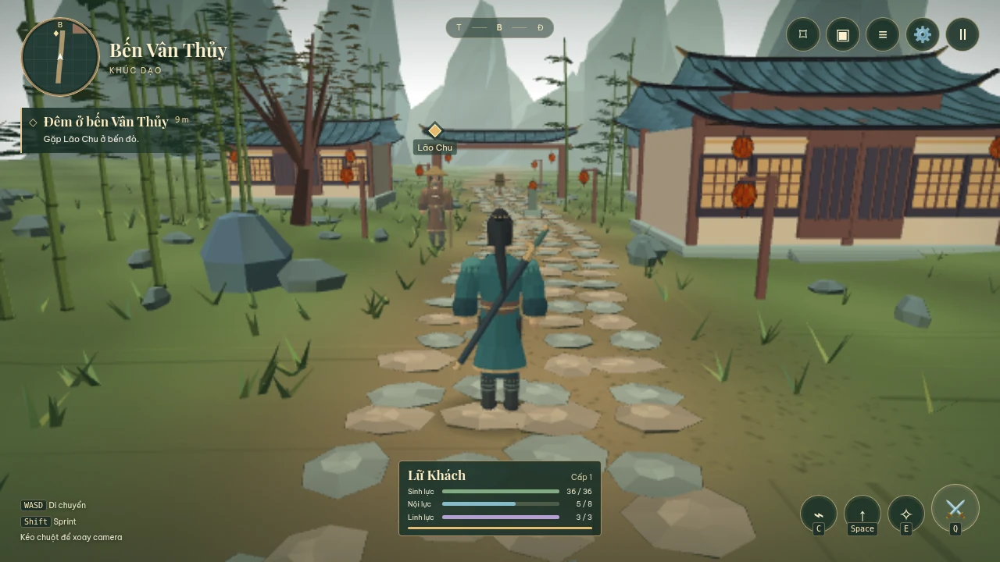

# Nghiệm thu foundation 3D

Chế độ Babylon.js chơi tại `/` của nhánh `feature/3d-action-rpg`. Chế độ Phaser có entry riêng `/legacy.html`. Bản thử dùng cùng lời thoại Khúc dạo và ghi tiến trình riêng.

Đã có địa hình bến Vân Thủy, camera sau lưng xoay và zoom, trọng lực, va chạm, nhảy, né, blend hoạt ảnh khung xương, HUD, điều khiển cảm ứng, hội thoại Lão Chu và bãi luyện ba nhát kiếm. Có các lớp đồ họa thực tế. Bản thử chưa có AI địch, boss, chiến đấu pha C hoàn chỉnh hay chuyển sang Chương 01.

Chạy production ở trang thử: `npm run build` rồi `npm run preview`. Thêm `?renderer=webgl` để kiểm tra đường WebGL 2. Kiểm thử và capture bằng `TM3D_SHOTS=/duong/dan/anh PLAYWRIGHT_CHROMIUM_EXECUTABLE_PATH=/usr/bin/chromium npm run test:e2e`.

## Ảnh từ Chromium

| Màn hình | Ảnh thực tế |
| --- | --- |
| Menu | [Mở hành trình](main-menu.webp) |
| Khám phá | [Bến, làng và núi](exploration.webp) |
| Tương tác | [Đến gần Lão Chu](npc-interaction.webp) |
| Thoại điện ảnh | [Góc máy cận Lão Chu](dialogue.webp) |
| Giao đấu thử | [Bài luyện kiếm với bia gỗ](sword-practice.webp) |
| Mobile | [HUD và joystick trên Pixel 7 giả lập](mobile.webp) |

Các ảnh ghi lại bản production trên renderer phần mềm. Ảnh WebP nằm ngoài `src/` và `public/`. Xem [số đo tải và FPS](PERFORMANCE.md).

## Kiểm thử

- 8 ca logic đạt, gồm chạy theo camera, trọng lực, va chạm, camera thu ngắn và hồi quy luật V0.5.
- 3 luồng Playwright cho V0.5 và 3 luồng cho bản 3D đạt qua các lượt kiểm thử riêng. Kiểm tra 3D có WebGL 2, chuyển động và va chạm theo luật, góc xoay/zoom, NPC và nhánh thoại, bài luyện kiếm, lưu và tải, dỡ scene, đa điểm chạm, preset và fullscreen theo thao tác người chơi.
- TypeScript strict, Vite production và Wrangler dry-run đạt. WebGPU có đường thử adapter và fallback nhưng chưa được xác nhận trên thiết bị hỗ trợ.
